<p align="center"></p>

<h1 align="center">FIFA Street (2012) - Fast, Documented, Online-ready</h1>

<p align="center">
<b>Verified specs</b> · <b>tools you can run</b> · <b>a tuned launcher</b> · <b>online setup in two clicks</b>
</p>

> **You need your own legally obtained copy of the game.** This repository contains **no game files, no game code and no
> recompiled binaries**. It holds original research, documentation, scripts and patches only.

## Why this is different

| | Typical port repo | This project |
|---|---|---|
| **Documentation** | none | Every offset and constant checked against real files (`tools/verify_all.py`: 0 failures, `verify_docs.py`: 0 mismatches in 75 values) |
| **Performance** | "set it to fast" | Measured: wrong GPU (Intel instead of RTX) found and fixed, readback modes benchmarked, fullscreen made as fast as windowed |
| **Colors** | black pitch or green tint on some settings | Root cause found (full-frame readback ranges); validated setting is the default |
| **Online** | manual | `Start-Launcher.cmd` creates your player file, the launcher does the rest |
| **Physics** | unknown | Ball radius, gravity (about 32.4 ft/s2), bounce restitution (about 0.55 measured) and the contact solver decoded |
| **Size** | n/a | This repo is small (docs and scripts, a few MB). The tuned launcher scripts add under 1 MB |

## What is in here

```
docs/        binary_formats.md  physics_spec.md  state_machine.md  architecture_map.md  performance.md  listings/
tools/       Python parsers (BIG4/BIGF, chunk decompressors, EA Attrib vault, nnet, GD.STRM) + live ball tracker + play.ps1
patches/     launcher-auto-gpu.patch  guest-memory-dump-hook.patch
assets/      banner and page art
```

## Play fast (Windows, D3D12)

1. Install the **official ReStreet launcher** from its releases page (the community project that makes the game run on PC) and point it at **your own** game data.
2. Copy `tools/play.ps1` next to the ReStreet `Binaries` folder (it launches `Binaries\fifastreet.exe`).
3. Run `play.cmd`-style: `powershell -ExecutionPolicy Bypass -File play.ps1 -Profile light`.

Settings that matter (all measured, see `docs/performance.md`):

| Setting | Result |
|---|---|
| Pick the discrete GPU (`-Adapter`, auto-selected) | fixes the "very laggy" case on laptops |
| Readback `some` (default) | correct colors, 115-140 FPS on an RTX 3060 laptop |
| Readback `fast` / skip lists | slower here and break colors: avoided |
| Fullscreen | same speed as a window |

## Online (first run)

1. Double-click **`Start-Launcher.cmd`** once. It creates `online.json` (server + a player name) and opens the launcher; the launcher then generates your personal key.
2. From then on open **`FifaStreetLauncher.exe`** as usual: the portal shows open matches and players online.
3. Never share `online.json` - it holds your key. Online uses the community ReStreet servers and their rules.

## Light on weak machines

The research and tooling are tiny. The game itself still needs its original data and a D3D12/Vulkan GPU; phones are **not** supported yet (that would need an ARM64 Android port, not started).

## For developers

* Start with `docs/binary_formats.md`, then `docs/physics_spec.md`.
* Every claim is marked verified or inferred. Run `python tools/verify_all.py` after pointing the paths at your own extracted data.
* The tools hard-code the author's paths: edit the constants at the top of each script.

## Credits and legal

Built on the community **ReStreet** project and ReXGlue. FIFA Street and EA are trademarks of Electronic Arts; this project is unofficial and not affiliated with EA. Game data and executables are not distributed here; use only a copy you own.
